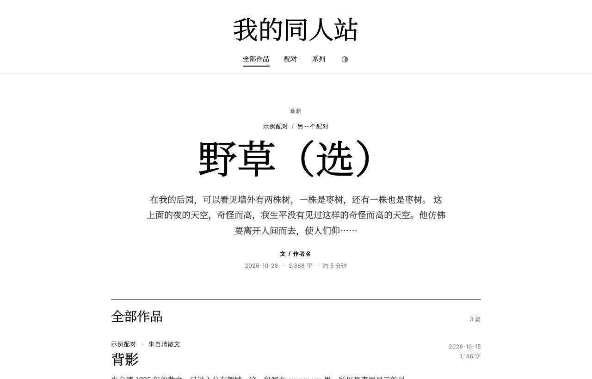
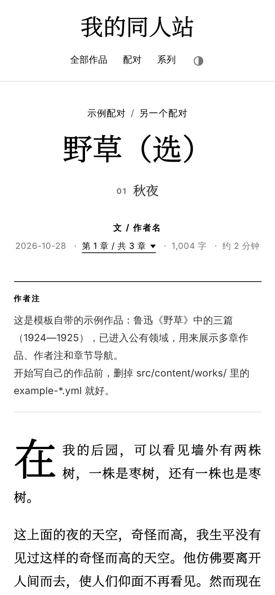

# 同人文存档模板

给自己搭一个放同人文的个人网站：杂志式排版，按 CP、系列整理作品，多章作品可以一章一页地读。**不用会写代码**，全程在网页上点点就能建好，以后在网页后台写文、改设置。网站本身免费托管，不用买服务器。

<p>
  
  
</p>

模板自带三篇示例作品（鲁迅《野草》选三篇、朱自清《匆匆》《背影》，都已经进入公有领域），方便你先看看效果，正式用之前删掉就行。

**目录**

- [能做什么](#能做什么)
- [准备工作](#准备工作)
- [第一步：复制一份自己的网站](#第一步复制一份自己的网站)
- [第二步：让网站上线](#第二步让网站上线)
- [第三步：打开网页后台](#第三步打开网页后台)
- [第四步：改网站设置](#第四步改网站设置)
- [第五步：写第一篇作品](#第五步写第一篇作品)
- [正文怎么写](#正文怎么写)
- [常见问题](#常见问题)
- [进阶：给会用命令行的人](#进阶给会用命令行的人)

## 能做什么

- **首页**：最新的一篇放大当头条，其他作品按更新时间排下去，作品多了自动分页。
- **配对**：列出所有 CP 和每个 CP 有几篇，点进去就是这个 CP 的全部作品。一篇作品可以有好几个 CP。
- **系列**：同一个系列的作品会串在一起，读完一篇可以直接点下一篇。
- **多章作品**：一章一页，有上一章 / 下一章，顶部能直接跳到任意一章。
- **作者注**：章前、章后的碎碎念会排成一块小字，和正文分开。
- **读起来舒服**：电脑和手机都适配，有深色模式、阅读进度条、字数和阅读时长。不喜欢哪个效果可以在设置里关掉。
- **搬家方便**：可以从 Word、txt、Markdown 或者 AO3 下载的网页导入作品，也能把全部作品一次打包下载备份（导入要用到命令行，见[进阶](#进阶给会用命令行的人)）。

## 准备工作

只需要两个免费账号，不用装任何软件：

- **GitHub 账号**：用来存放你的网站和作品。到 <https://github.com/signup> 注册。
- **Cloudflare 账号**：用来把网站放到网上。到 <https://dash.cloudflare.com/sign-up> 注册。

> 想用 GitHub 自带的 GitHub Pages 代替 Cloudflare 也可以，见[进阶](#用-github-pages-部署)。

## 第一步：复制一份自己的网站

1. 登录 GitHub，打开这个模板的页面（就是你现在看的这页）。
2. 点右上角绿色的 **Use this template**，再点 **Create a new repository**。
3. **Repository name** 填一个英文名字，比如 `my-fanfic`。它会出现在网址里，以后改起来麻烦，建议想好再填。
4. 选 **Public**（公开）或 **Private**（私有）都可以，网站都能正常上线。区别是：公开的话，别人在 GitHub 上也能看到你的原始文件。
5. 点 **Create repository**。

现在你有了一份自己的网站，之后的修改都在这一份里，不会影响模板。

## 第二步：让网站上线

1. 登录 [Cloudflare](https://dash.cloudflare.com)，左边菜单选 **Workers & Pages**。
2. 点 **Create application**，选上方的 **Pages** 标签，再点 **Import an existing Git repository**。
3. 第一次用会让你连接 GitHub，按提示授权，允许它访问刚才建的仓库。
4. 选中你的仓库（比如 `my-fanfic`），点 **Begin setup**。
5. 按下面填写，其余保持默认：
   - **Production branch**：`main`
   - **Build command**：`npm run build`
   - **Build output directory**：`dist`
   - **Project name**：会变成你的网址 `<项目名>.pages.dev`，可以改成喜欢的英文名
6. 点 **Save and Deploy**，等一两分钟。

完成后会给你一个 `https://<项目名>.pages.dev` 的网址，打开就是你的网站。之后每次在后台保存，网站都会自动更新。

> Cloudflare 的界面偶尔会调整，按钮名字可能和这里略有不同，找意思相近的就行。

## 第三步：打开网页后台

网页后台用的是 [Pages CMS](https://pagescms.org)，用 GitHub 账号登录。

1. 打开 <https://app.pagescms.org>，点用 GitHub 登录。
2. 第一次使用会让你安装 Pages CMS 的 GitHub App。选择只允许它访问你的网站仓库就好。
3. 回到 Pages CMS，在列表里点你的仓库。

左边会出现两个入口：

- **作品**：所有作品的列表，在这里新建、修改、删除作品。
- **网站设置**：站名、作者名、页脚链接和各种功能开关。

> 想让朋友帮忙改文（比如校对的太太），她不需要 GitHub 账号：在 Pages CMS 里可以用邮箱邀请协作者。

## 第四步：改网站设置

在后台点 **网站设置**：

- **站名**：显示在网页最上面和浏览器标签上。
- **作者名**：显示在每篇作品标题下面（「文 / 作者名」）和页脚。
- **网站简介**：别人分享你的链接时会显示这段话。
- **页脚链接**：比如你的 AO3、微博、Lofter 主页，点「Add an item」一条一条加。
- **功能开关**：每一项都是一个勾选框，比如不想要首字放大、不想显示阅读时长，取消勾选就好。
- **深色模式**：跟随系统并显示切换按钮 / 只跟随系统 / 始终浅色。

改完点右上角保存，一两分钟后网站上就能看到变化。

## 第五步：写第一篇作品

**先删掉示例作品**：在 **作品** 列表里，点三篇示例作品（野草、匆匆、背影）右边的 ⋮ 菜单，选删除。

**新建作品**：在 **作品** 页面点右上角的 **＋**，然后：

1. **作品名**：必填。
2. **文件名**（只在新建时出现）：决定作品的网址，比如改成 `rain.yml`，网址就是 `/works/rain/`。默认用作品名，中文也可以，后面的 `.yml` 不要删。
3. **CP**：点「Add an item」加一个，有几个就加几个。同一个 CP 每次都写成一模一样的名字，网站才会把它们归到一起。
4. **更新日期**：决定作品在首页的先后顺序，新的在前。
5. **简介**：不填的话，列表里会显示正文开头的一段。
6. **系列** 和 **系列里的第几篇**：属于某个系列就填上，名字写得一模一样的作品会自动归成一个系列。
7. **连载状态**：连载中 / 已完结，不填就不显示。
8. **章节**：每一章是一张卡片，有「章节名」和「正文」两格。
   - 单章作品只留一张卡片，章节名可以不填。
   - 多章作品点「Add an item」加一章，拖动卡片左边的 ⠿ 可以调整章节顺序。

最后点保存。等一两分钟，刷新你的网站就能看到新作品了。

## 正文怎么写

正文框是纯文本，用几个简单的记号排版（这种写法叫 Markdown）：

| 想要的效果 | 这样写 |
|---|---|
| 分段 | 段落之间空一行 |
| **粗体** | `**粗体**` |
| *斜体* | `*斜体*` |
| ~~删除线~~ | `~~删除线~~` |
| 场景分隔（显示成 ♦） | 单独一行写 `***` |
| 段内换行（不分段） | 在行末写 `<br>` |

**作者注**：写在一章的开头或结尾，网站上会排成一块小字，和正文分开：

```html
<aside class="author-note" aria-label="作者注">

这里写作者注，可以写好几行。

空一行就是新的一行。

</aside>
```

写在章末的话，把「作者注」改成「章末注」，显示的小标题就会跟着变。

## 常见问题

**保存之后网站没变？**
网站要重新生成，通常一两分钟。过了很久还没变，到 Cloudflare 的 **Workers & Pages** → 你的项目 → **Deployments** 看看最新一次是不是失败了，点进去能看到原因。大多是作品里有格式问题，比如某一章没写正文，日志里会写是哪篇作品的第几章。

**怎么删除或修改作品？**
在后台 **作品** 列表里点开作品直接改；删除在作品右边的 ⋮ 菜单里。

**能用自己的域名吗？**
可以。在 Cloudflare 项目的 **Custom domains** 里添加你买的域名，按提示操作。国内访问 `pages.dev` 和 `github.io` 有时不太稳定，绑定自己的域名通常会好一些。

**怎么备份全部作品？**
到 GitHub 仓库的 **Actions** 页面，左边选「导出作品」，点 **Run workflow**。几分钟后在仓库的 **Releases** 页面能下载到一个 zip，里面每篇作品一个 Markdown 文件（任何文本编辑器都能打开）。默认是草稿，只有你自己能看到；运行时选「公开」的话，所有能看到仓库的人都能下载。

**网站会被搜索引擎搜到吗？**
会的，和普通网站一样。如果只想给知道网址的人看，可以把仓库设成私有，不过网站本身仍然是公开的，知道网址就能打开。

**模板以后更新了，我能用上吗？**
可以，但需要用到命令行，见[进阶](#从模板同步更新)。

---

## 进阶：给会用命令行的人

下面这些需要在电脑上装 [Node.js](https://nodejs.org)（22.23.4 以上，版本写在 `.node-version`）和 git。

### 在电脑上预览

```
npm install
npm run dev      # 打开 http://localhost:4321 预览
npm run build    # 生成网站到 dist/
```

### 作品文件的格式

一篇作品是 `src/content/works/` 里的一个 `.yml` 文件，作品信息和所有章节都在里面。文件名就是网址（`野草.yml` → `/works/野草/`）。

```yaml
title: 野草
cp: [示例配对]          # 可以写多个：[示例配对, 另一个配对]
updated: 2026-10-28     # 决定首页排序
series: 鲁迅散文诗       # 同名系列自动归在一起（可不写）
seriesOrder: 1          # 系列里的第几篇（可不写）
summary: 一句话简介       # 不写就自动取第一章开头
status: finished        # ongoing（连载中）/ finished（已完结），不写不显示
chapters:
  - title: 秋夜
    body: |
      第一章正文，每行前面空六格。

      空一行是分段。
  - title: 好的故事
    body: |
      第二章正文……
```

除了 `title` 和 `chapters`，其他都可以不写。章节顺序就是列表顺序，网址按顺序生成（第二章 → `/works/野草/02/`）。写错了，构建时会报错并指出是哪篇作品、哪一章。

### 导入作品

```
npm run import -- 新作品.md            # 文件名就是网址：新作品.md → /works/新作品/
npm run import -- 草稿/*.txt           # 一次导入多篇
npm run import -- 新作品.docx --force  # 覆盖已有的同名作品
```

| 格式 | 作品名 | 怎么分章 | 其他 |
|---|---|---|---|
| `.md` | 开头 `---` 里的 `title` | `# 章节名` | 作品信息写在开头（见下） |
| `.txt` | 文件名 | 「第一章」「第二章：重逢」「番外」「Chapter 1」「# 章节名」这样单独一行 | 整篇没有空行时每行算一段；GBK 编码也能读 |
| `.docx`（Word） | 文件名；开头只有一个「标题 1」时用它 | 「标题 1」样式的段落（开头有「标题 1」当作品名时，用「标题 2」） | 保留加粗、斜体 |
| `.html`（AO3 下载） | 作品标题 | AO3 的章节 | 自动读出 CP（Relationship）、系列、更新日期、连载状态、简介，作者注变成作者注区块，去掉 AO3 的提示文字 |

AO3 的 CP 名通常很长（比如 `Kimura Keito/Sawamoto Natsuki`），导入后可以在后台改成简称。

Markdown 的写法：开头 `---` 之间写作品信息（字段和上面的 yml 一样），下面写正文；多章作品每章前面写一行 `# 章节名`，单章作品不用写。正文里的小标题请用 `##`，`#` 留给分章。

```markdown
---
title: 野草
cp: [示例配对]
updated: 2026-10-28
---

# 秋夜

第一章正文……

# 好的故事

第二章正文……
```

### 导出作品

`npm run export` 把每篇作品导出成一份 Markdown，放到 `export/`（不进 git）。想改完放回网站，用导入命令加 `--force`。GitHub 上的「导出作品」Action 做的是同一件事，再打包成 zip 发到 Releases。

### 网站设置和功能开关

网站设置在 `src/site.yml`，和后台「网站设置」是同一个文件。没写的项目用默认值，写错了构建时会指出是哪一项。

| 开关 | 作用 |
|---|---|
| `leadStory` | 首页第一页把最新一篇做成大标题头条 |
| `dropCap` | 正文第一个字放大（首字下沉） |
| `endMark` | 完结章最后一段末尾加 ♦ |
| `progressBar` | 章节页顶部的阅读进度条 |
| `wordCount` | 显示字数 |
| `readingTime` | 显示预计阅读时长 |
| `byline` | 标题下的「文 / 作者」署名 |
| `chapterPicker` | 多章作品点「第 N 章 / 共 M 章」弹出章节菜单 |
| `keyboardNav` | 键盘 ← → 翻章 |
| `related` | 文末「更多同 CP 作品」推荐 |
| `autoSummary` | 没写简介时，列表里自动显示正文开头 |
| `darkMode` | `auto` 跟随系统并显示切换按钮；`system` 只跟随系统；`off` 始终浅色 |

没有任何作品写 CP 或系列时，导航里的「配对」「系列」会自动隐藏。

界面上的文字（「全部作品」「配对」等）在 `src/site.config.ts` 的 `ui` 里；颜色和字体在 `src/styles/global.css` 开头。

### 字体

- 中文：思源屏显臻宋（思源宋体的屏幕显示优化版，基于 SIL OFL 1.1），来自[中文网字计划](https://github.com/KonghaYao/chinese-free-web-font-storage)的 npm 包 `@chinese-fonts/sypxzs`，已按字频切片，浏览器只下载页面用到的部分。
- 西文：Libre Caslon Text / Display（OFL），来自 Fontsource。
- 字体文件和网站一起部署，不依赖外部 CDN，国内也能正常加载。

### 用 GitHub Pages 部署

1. 把 `.github/workflows/deploy.yml.example` 改名为 `deploy.yml`。
2. 改 `astro.config.mjs`：仓库叫 `<用户名>.github.io` 时 `base` 保持 `'/'`；其他仓库名设 `base: '/<仓库名>/'`；两种都加上 `site: 'https://<用户名>.github.io'`。
3. 仓库 Settings → Pages → Source 选 **GitHub Actions**。

之后每次推送到 main 都会自动部署。用 Cloudflare 的话不用管这个文件，它不会运行。

### 从模板同步更新

```
git remote add template https://github.com/locoda/fanfic-site-template.git
git fetch template
git merge template/main --allow-unrelated-histories   # 第一次需要这个参数，以后直接 git merge template/main
```

有冲突时，`src/site.yml`、`src/content/works/` 和你自己的 README 保留你的版本，其他文件一般用模板的版本；合并进来的示例作品（`example-*.yml`）删掉即可。想让 README 和 `site.yml` 以后自动保留你的版本，可以加一个 `.gitattributes`：

```
README.md merge=ours
src/site.yml merge=ours
```

再运行一次 `git config merge.ours.driver true`。

## 授权

代码以 [MIT](LICENSE) 授权，随便用、随便改。示例作品属于公有领域（文字来自维基文库）。字体都是 SIL OFL 授权，可免费商用。你自己写的作品版权归你。
